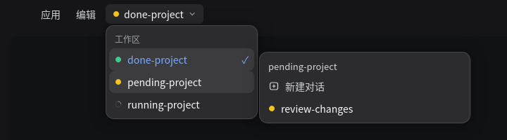

<div align="center">

# dsh-titlebar-workspace

**A workspace switcher for the DeepSeek Harness Desktop titlebar.**

> Unofficial community plugin.

[](README.md) [](README.en.md)

[](https://github.com/deepseek-ai/deepseek-harness) [](LICENSE)

</div>



## Install

Install this directory as a profile bundle: through the plugin page, or by pointing `plugin_manager` at it. If the titlebar does not show it, refresh the page (`Ctrl+R`) or restart the app.

After publishing to GitHub:

```sh
dsh plugin --profile desktop add github:ExcitedEven/dsh-titlebar-workspace
```

## Usage

1. Click the workspace name in the titlebar to list every workspace.
2. Hover (or focus) a workspace to expand its conversations on the right.
3. Click a workspace to open its most relevant conversation: waiting first, then unread, then running, newest when tied; an empty workspace starts a new one.
4. Click a conversation to open it. "New conversation" reuses an existing blank instead of piling up empties, and the list stays open so the result is visible.
5. Click outside, press `Esc`, or let a dialog open and the menu closes.

## Status

- **Yellow**: a workspace is waiting for you (approval, plan review, question).
- **Green**: a conversation finished and you have not read it.
- **Spinner**: a conversation is running.
- The chip carries the most urgent state across all workspaces, so a warning in another project is visible (hover names the workspace); each workspace row shows its own aggregate, and every conversation row its own dot.
- Blank conversations match the sidebar: only the current "New conversation" is listed; other blanks are hidden and never count toward a status or a click target.

## Why the button is in the titlebar

The titlebar's native menu is built in the Electron main process and has no extension point for plugins. This plugin puts its control in the titlebar row instead: aligned with the titlebar controls and using their size, font and hover color, so it reads as part of the titlebar. When the titlebar menu host is missing, the plugin renders nothing and does not affect other plugins.

The dropdown and flyout are mounted at the top of the page, so the right sidebar cannot cover them; they close when a real dialog opens.

## Requirements

- **Desktop only**: not rendered in a plain browser.
- `dsh >= 0.2.0` (`dsh.engines.dsh`).
- Zero runtime dependencies; source in TypeScript (`src/`), `lib/` is the `npm run build` output (committed, so a `link:` install needs no build).
- A 200ms poll follows titlebar layout changes (one rect read; negligible).
- Restarting the app reloads the plugin; sessions and files stay on disk.

## Uninstall

Settings → Plugins → `dsh-titlebar-workspace` → disable or uninstall; the titlebar control disappears.

## File structure

| File | Purpose |
| --- | --- |
| `src/client.ts` | Browser side: titlebar control, dropdown and flyout, status dots, navigation |
| `src/index.ts` | Host side: just a Loader row; no services or tools |
| `lib/` | `tsc` build output (`client.js`, `index.js`) |
| `cordis.patch.yml` | Bundle patch that inserts the entry |
| `test/` | jsdom test: placement, layout shift, dots, blank sessions, click targets |
| `tools/` | Preview generator (renders the README image) |
| `assets/` | README screenshot |

## Development

```sh
npm install
npm run build     # src/ → lib/
npm test
npm run preview   # writes tools/titlebar-preview.html
```

## Versioning

The version follows [Semantic Versioning](https://semver.org/): MAJOR for breaking changes, MINOR for features, PATCH for fixes. Update [CHANGELOG.md](CHANGELOG.md) for every release.

```sh
npm version patch   # or minor / major; bumps package.json and tags vX.Y.Z
git push --follow-tags
```

Then publish through the plugin market or `npm publish`.

## License

MIT

