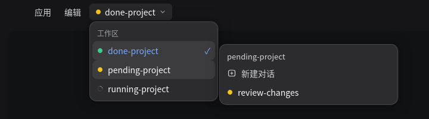

<div align="center">

# dsh-titlebar-workspace

**给 DeepSeek Harness Desktop 的顶栏加一个工作区切换器。**

> 非 DeepSeek 官方插件，社区插件。

[](README.md) [](README.en.md)

[](https://github.com/deepseek-ai/deepseek-harness) [](LICENSE)

</div>



## 安装

把本目录作为 profile bundle 安装：通过插件页，或让 `plugin_manager` 指向这个目录。装完如果顶栏没有出现，刷新一次页面（`Ctrl+R`）或重启应用。

发布到 GitHub 之后也可以直接安装：

```sh
dsh plugin --profile desktop add github:ExcitedEven/dsh-titlebar-workspace
```

## 用法

1. 点顶栏上的工作区名字，下拉列出所有工作区。
2. 鼠标移到某个工作区（或用键盘聚焦），右侧展开它的对话列表。
3. 点工作区 = 打开最该看的那条对话：等待处理优先，其次未读，再其次运行中；同状态取最新的；空工作区则新建一条。
4. 点对话 = 直接打开它；「新建对话」会复用已有的空白对话，不会堆出一串空会话，列表保持展开让你看到结果。
5. 点外面、按 `Esc`，或者有弹窗出现时，菜单自动收起。

## 状态提示

- **黄色**：有工作区在等你（审批、计划评审、提问）。
- **绿色**：有对话跑完了，你还没看过。
- **转圈**：对话正在运行。
- 顶栏上的点取**所有工作区**里最紧急的状态，所以别的项目在等你时也能看到（悬停会显示是哪个工作区）；每个工作区行显示自己的聚合状态；每条对话行显示自己的状态点。
- 空白会话与侧栏一致：只显示当前那个「新对话」，其它空白会话隐藏，也不参与状态计算或点击选择。

## 为什么按钮在顶栏

顶栏的原生菜单在 Electron 主进程里构造，没有留给插件的扩展点。本插件改为把控件放进顶栏那一行：位置对齐顶栏控件，尺寸、字号、悬停色也与它们一致，所以看起来是顶栏的一部分。找不到顶栏菜单宿主时插件什么都不渲染，也不影响其它插件。

下拉菜单与对话浮层直接挂到页面的最上层，不会被右侧栏盖住；出现真正的弹窗时会自动收起。

## 要求与限制

- **仅桌面端**：普通浏览器里不渲染。
- 需要 `dsh >= 0.2.0`（`dsh.engines.dsh`）。
- 运行时零依赖；源码是 TypeScript（`src/`），`lib/` 是 `npm run build` 的产物（已提交，`link:` 安装无需构建）。
- 侧栏收放时顶栏控件会整体移动，插件用 200ms 轮询跟随（只读一次位置，开销很小）。
- 重启应用会重新加载插件；会话与文件都在磁盘上，不受影响。

## 卸载

设置 → 插件 → `dsh-titlebar-workspace` → 停用或卸载，顶栏控件随之消失。

## 文件结构

| 文件 | 作用 |
| --- | --- |
| `src/client.ts` | 浏览器端：顶栏控件、下拉与浮层、状态点、跳转 |
| `src/index.ts` | Host 半区：只需一个 Loader 行，不注册服务或工具 |
| `lib/` | `tsc` 构建产物（`client.js`、`index.js`） |
| `cordis.patch.yml` | bundle patch，插入一行插件 |
| `test/` | jsdom 测试：定位、布局变化、状态点、空白会话、点击目标 |
| `tools/` | 预览生成器（生成 README 里的示意图） |
| `assets/` | README 截图 |

## 开发

```sh
npm install
npm run build     # src/ → lib/
npm test
npm run preview   # 生成 tools/titlebar-preview.html
```

## 版本与发布

版本号遵循 [语义化版本](https://semver.org/lang/zh-CN/)：破坏性变更升 MAJOR，新功能升 MINOR，修复升 PATCH；每次发布先更新 [CHANGELOG.md](CHANGELOG.md)。

```sh
npm version patch   # 或 minor / major；改 package.json 并打 vX.Y.Z tag
git push --follow-tags
```

之后在插件市场或通过 `npm publish` 发布。

## License

MIT

